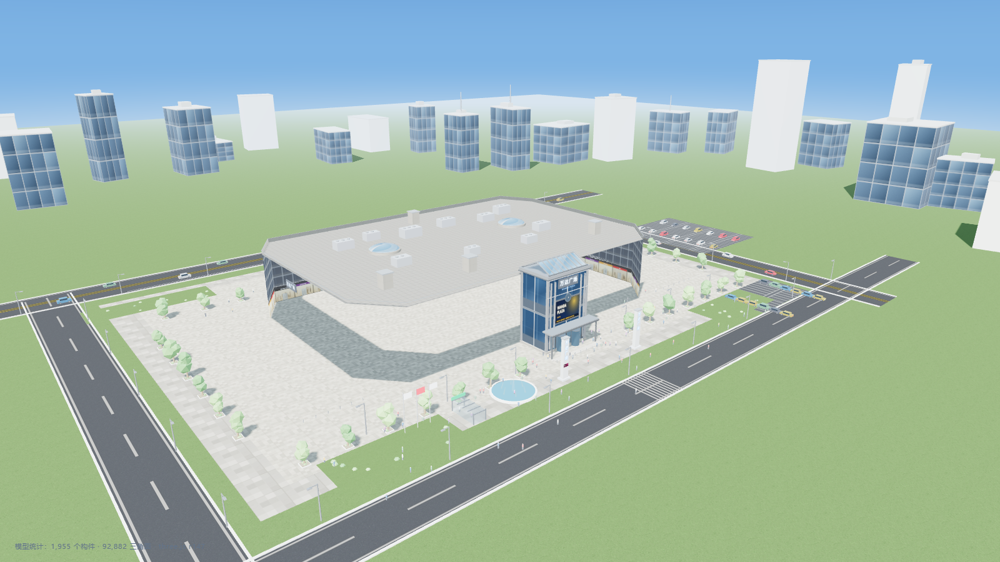
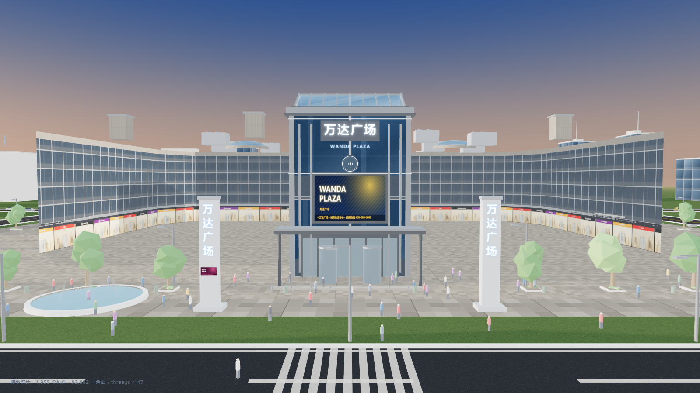
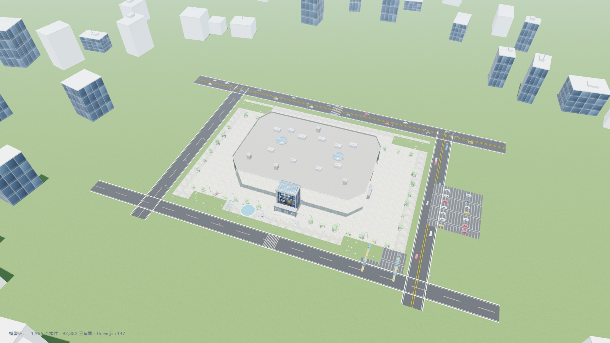
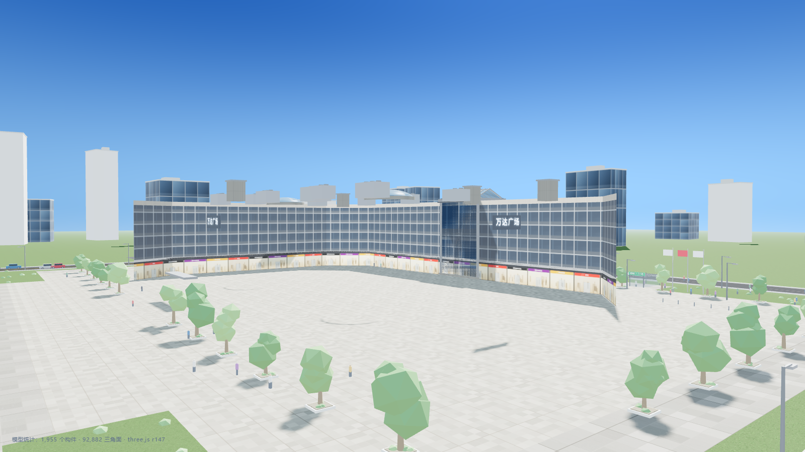
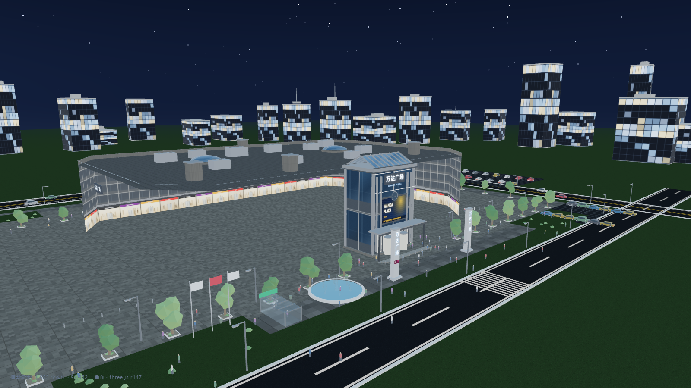
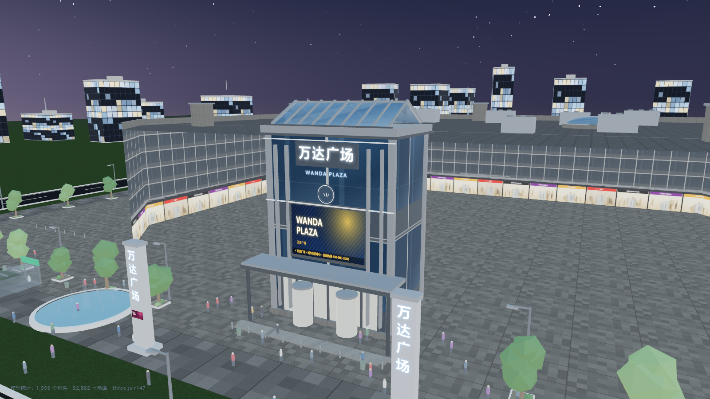

# 万达广场 · 程序化 3D 模型

用代码从零生成的**万达广场**三维模型 —— 全部几何体与贴图均由程序实时计算，
不含任何外部模型或图片素材（three.js 已本地化，可完全离线运行）。



---

## 快速开始

直接双击 `index.html` 即可（无需服务器、无需联网）。

如需本地起服务：

```powershell
cd wanda-plaza-3d
python -m http.server 8080     # 然后访问 http://localhost:8080
```

## 交互说明

| 操作 | 说明 |
| --- | --- |
| 鼠标左键拖拽 | 旋转视角 |
| 滚轮 / 双指 | 缩放 |
| 鼠标右键拖拽 | 平移 |
| 视角预设 | 全景 / 主入口 / 鸟瞰 / 街景 / 夜景 / 中庭 |
| 时间滑杆 | 拖动改变日照角度（0–24 时），实时驱动太阳位置、天空、雾与夜间灯光 |
| 昼夜循环 | 自动播放一天的日照变化 |
| 显示选项 | 自动旋转、车流、人群、阴影、周边城市、大气雾 |
| 导出 GLB | 导出为 `wanda-plaza.glb`，可导入 Blender / Unity / UE / 三维查看器 |
| 截图 | 保存当前画面为 PNG |

## 模型内容

**主体建筑（购物中心）**
- 圆角矩形体量，约 132 m × 90 m，裙房高 24.5 m，地上 4 层
- 首层商业橱窗（含 21 个品牌店招灯箱，程序化生成，各不相同）
- 上部玻璃幕墙（4 m 层高 × 4 m 开间的真实分格）
- 铝板腰线、女儿墙及压顶、屋面（含冷却塔、空调机组、排风井、采光穹顶）
- 北侧出挑**中庭体量**：入口门厅、雨棚、旋转门、双坡玻璃采光顶
- 标识系统：**「万达广场」发光字**（含 WANDA PLAZA 副标）、圆形 LOGO、
  **LED 大屏**（5 组广告轮播）、精神堡垒、影城 IMAX 标识、西/南立面副招牌
- 夜间立面轮廓灯带

**场地与城市**
- 广场石材铺装、道路系统（含车道线、双黄线、人行横道、路缘石）
- 地面停车场（含车位划线）、绿化（行道树、草坪、灌木）
- 水景喷泉、精神堡垒、地铁出入口、公交站台、路灯、护栏、隔离柱、旗杆、垃圾桶
- 动态配景：车流（沿车道循环行驶）、人群（漫步动画）
- 周边城市天际线：56 栋程序化建筑，夜间随机亮灯

## 技术实现

```
wanda-plaza-3d/
├── index.html              页面外壳 + 控制面板
├── src/
│   ├── utils.js            程序化贴图（Canvas）+ 几何工具库
│   ├── mall.js             主体建筑建模
│   ├── site.js             场地、配景、城市环境
│   └── app.js              场景装配、光照/日夜系统、相机、导出
├── tools/glb-export.mjs    无头导出 GLB（Chrome DevTools Protocol）
├── shots.ps1               无头批量渲染各视角截图
├── vendor/                 three.js r147（本地化）
└── wanda-plaza.glb         导出的模型文件
```

**关键做法**
- **贴图全部用 Canvas 2D 实时绘制**：幕墙、橱窗、铺装、沥青、草地、汉字招牌、LED 内容、
  夜间窗光等共 15 类贴图生成器，按真实物理尺寸（米）计算 UV 重复次数，因此分格比例真实。
- **沿轮廓生成墙面**：`buildWallRing()` 沿多边形逐边生成竖直墙面，UV 按实际边长铺贴，
  保证幕墙分格在转角处不错位。
- **日夜系统**：按小时计算太阳高度角/方位角，驱动平行光、半球光、环境光、天空着色器
  （含太阳光晕、地平线霞光、夜间星空）与雾色；夜间自动点亮橱窗、LED、招牌、轮廓灯、
  路灯与周边建筑窗光。
- **环境反射**：用 `PMREMGenerator` 从程序化渐变场景生成环境贴图，赋予幕墙玻璃反射质感。
- **材质共享池**：车辆/树木/行人共用材质，材质数由 1054 降至 186，显著减小导出体积。

## 模型统计

| 指标 | 数值 |
| --- | --- |
| 构件数 | 约 1,955 个 |
| 三角面 | 87,690 |
| 材质 | 187 |
| 贴图 | 39（全部程序化生成） |
| GLB 体积 | 16.06 MB |

## 视角预览

| 视角 | 预览 |
| --- | --- |
| 全景（15:30） |  |
| 主入口（17:36 暮色） |  |
| 鸟瞰（11:00） |  |
| 街景（08:24） |  |
| 夜景（20:24） |  |
| 中庭（19:12） |  |

## 命令行工具

```powershell
# 批量渲染视角截图到 shots/
.\shots.ps1                    # 全部 8 个视角
.\shots.ps1 overview night     # 指定视角

# 无头导出 GLB 模型
node tools\glb-export.mjs
```

> 无头渲染使用 Chrome 的 SwiftShader 软件渲染，单张约 30–150 秒。

## 说明

本项目为**程序化建模作品**，建筑形体与立面构图为艺术化还原，
并非万达广场任何具体项目的实测图纸；品牌店招仅作视觉示意。
